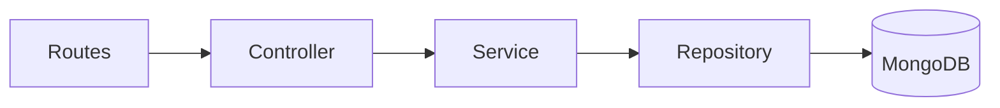
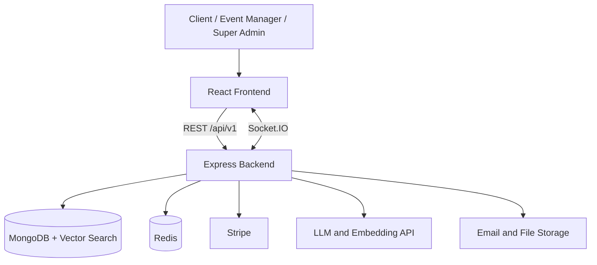

Elanora — AI-Powered Event Management Platform
Elanora is a multi-company event management platform built with the MERN stack and TypeScript. A client plans one event and books every service for it (food catering, stage decoration, photography, makeup and more) from different event management companies in one place, then pays online with Stripe. An AI assistant, built with an LLM and RAG, helps clients create and choose packages.
Status: 🚧 In Development

A multi-company event marketplace that brings event planning, service booking, package customization, AI-powered recommendations, and online payments together in one place.
📚 Table of Contents
- Overview
- User Roles
- How It Works
- Features and Status
- Tech Stack
- Architecture
- SOLID Principles
- AI: LLM and RAG
- Database Design
- API Standards
- Security
- Quality, Logging and Testing
- Deployment
- Development Workflow
- License
✨ Overview
Planning an event usually means calling many event management companies one by one and paying each separately. Elanora puts the whole process in one flow: event management companies list service packages, and the client chooses, customizes, books and pays inside the app. The platform earns a 10% commission on every payment.

Key ideas:
- Multi-company marketplace. Many event management companies sell on one platform.
- One event management company per service. A client can choose Company A for catering and Company B for decoration in the same event. Only one package is allowed per service in an event.
- Dynamic service forms. The super admin creates each service and designs its own form, so new service types need no code changes.
- Four ways to choose a package. AI recommended, AI chatbot custom package, listed package and saved package.
- Approval before payment. The company reviews each request and sets the final price.
- Split payments. 50% advance, balance paid shortly before the event, commission taken automatically.
- Wallets and refunds. Refunds and earnings go to wallets, and money can only be redeemed, never added.
- Dispute handling. A concern goes to the company first and is escalated to the super admin if unresolved.
👥 User Roles
Elanora has three types of users: client, event manager and super admin.
Role	Description	Access
Client	A person booking an event	Signs up and logs in
Event Manager	Runs an event management company on Elanora	Signs up with company details and documents. Login is locked until the super admin approves.
Super Admin	The platform owner	Login only. Credentials are added directly to the database.

🔄 How It Works
1. An event manager signs up with the event management company's details and documents. The request is pending.
2. The super admin approves or rejects it. The event manager can log in only after approval.
3. The super admin creates a service, builds its form, and publishes it.
4. Approved companies create event types, themes and packages.
5. A client creates an event and picks a package for each service.
6. For services that need it (such as stage decoration), the client and company agree on a venue visit.
7. The company approves the request and sets the final amount.
8. The client pays 50% in advance, then the balance 1 to 2 days before the event.
9. The company delivers the service. The client then reviews it.
10. If the client cancels, the refund goes to the client wallet based on the cancellation policy.
✅ Features and Status
The checklist below tracks planned and implemented work. Items are unchecked while they are still in progress.
- [ ] Authentication: signup, login, forgot password, OTP, resend OTP (Client, Event Manager, Super Admin)
- [ ] Super admin user listing with pagination, search and filters
- [ ] Layered architecture with the repository pattern, linting and logging
- [ ] Company approval, services and dynamic form builder
- [ ] Packages, event types and themes
- [ ] Event booking with the four package options and customization
- [ ] Venue visit flow
- [ ] Stripe payments, wallet, cancellation and refunds
- [ ] Workers, milestones and reviews
- [ ] Concerns and disputes
- [ ] Chat, file sharing, calls and notifications
- [ ] AI chatbot and package recommendations (LLM and RAG)
🛠️ Tech Stack
Area	Technology
Frontend	React, TypeScript, Vite, Tailwind CSS, React Router, Redux Toolkit, React Hook Form, Zod
Backend	Node.js, Express, TypeScript (strict mode)
Database	MongoDB with Mongoose, schema validation and transactions
Vector search	MongoDB Atlas Vector Search (for RAG)
Authentication	JWT access and refresh tokens, bcrypt, email OTP with Nodemailer
Payments	Stripe, confirmed through webhooks
AI	An LLM API (Gemini or OpenAI), an embedding model, RAG, and optionally LangChain or LlamaIndex
Real time	Socket.IO for chat and notifications, WebRTC for audio and video calls
Caching	Redis for frequently read data such as services, packages and settings
File storage	Cloudinary or AWS S3, served through a CDN
Validation	Zod on every request
Logging and monitoring	Winston (JSON logs), Prometheus and Grafana
Code quality	ESLint, Prettier, Husky, lint-staged
Testing	Jest and Supertest, target of at least 80% coverage
API documentation	Postman and Swagger (OpenAPI)
Deployment	Docker, Nginx, and a cloud provider (AWS, Azure or GCP)

🏗️ Architecture
Elanora uses a layered architecture with the repository pattern. We chose it because it separates HTTP handling, business rules and database access. Each file stays small, the database becomes replaceable, and services can be tested with mock repositories.

Layer	Responsibility
Routes	Map the URL and method to a controller, and attach middlewares (auth, role, validation, rate limit)
Controller	Read the request, call a service, send the response. No business logic.
Service	Business rules such as booking, approval, payment split, refunds and OTP checks
Repository	The only layer that talks to MongoDB. Services depend on repository interfaces.
Model	Mongoose schemas and TypeScript types

Files are organised by resource (auth, user, package, event, payment and so on), so related files stay together. The frontend follows the same idea: Page, Component, Hook, Service, then Repository (the only layer that calls the API).

The overall system looks like this:

🧩 SOLID Principles
Principle	How Elanora applies it
Single Responsibility	Each layer has one job. Controllers handle HTTP, services hold business rules, repositories handle data.
Open/Closed	New behaviour is added by writing a new implementation, not by editing working code. A new payment or LLM provider is a new class.
Liskov Substitution	Any repository implementation can replace another. The real MongoDB repository and a mock used in tests behave the same to the service.
Interface Segregation	Interfaces are small and focused, such as separate repository interfaces for users and OTPs, and separate interfaces for mailer, payment gateway and LLM provider.
Dependency Inversion	Services depend on interfaces, and the concrete classes are passed in through the constructor. This also keeps AI and Stripe behind swappable service layers.

🤖 AI: LLM and RAG
Elanora uses an LLM to turn a client's plain-language request into a usable package, and RAG to make sure the answer uses real packages, items and prices from the platform instead of invented ones.
What the AI does
- AI chatbot custom package. The client types a request, for example starters, juices and a main course. The assistant builds a draft package, asks whether the client wants to edit it, and then lists companies that provide the service.
- AI recommended package. The assistant suggests packages that match the service, event type, theme, guest count and budget, with a short reason for each.
RAG pipeline
1. Index. When a package is created or updated, its service, event type, theme, items, price, highlights and company rating are turned into text and converted to an embedding. The embedding is stored in MongoDB and indexed with Atlas Vector Search.
2. Retrieve. The client's prompt and event details (service, event type, theme, guests, budget) are embedded, and a vector search finds the closest packages and items. Results are filtered to active packages of the chosen service.
3. Augment. The retrieved packages, items and prices are placed in the prompt as trusted context.
4. Generate. The LLM returns the draft package as structured JSON. Prices and items come from the retrieved data. If an item is not found, the draft marks its price as pending for the company to set.
5. Validate. The server checks the JSON against a schema before saving it as the draft package. Invalid output is rejected and retried or replaced by a fallback.
6. Re-rank (recommendations). Similarity score is combined with rating and price fit, and the LLM writes the short reason.
Design rules
- All AI code sits behind a service layer with provider interfaces (LLM provider and embedding provider), so the provider can be swapped without touching other code.
- AI keys stay on the server in environment variables and are never sent to the frontend.
- User text is treated as data, not instructions, to reduce prompt injection. The model cannot call internal APIs or change prices.
- Only the data needed for the task is sent to the provider. No passwords, tokens or payment details.
- If the LLM fails or times out, the app falls back to rule-based recommendations and the normal package list.
- Requests are rate limited, and token usage and response time are logged.
- LangChain or LlamaIndex may be used for the multi-step pipeline if they simplify it.
🗄️ Database Design
- MongoDB, with an ObjectId for every id and references between collections.
- Small child records live inside their parent: form fields in service forms, items in packages, items, venue visits, workers and milestones in event services, allocations in payments, updates in concerns, and AI messages in AI sessions.
- Large or fast-growing data has its own collection: messages, call logs, notifications, wallet transactions, reviews and refunds.
- A booking keeps a copy of the package name, price and items, so later package edits never change old bookings.
- Payments, wallet changes and refunds run inside MongoDB transactions.
- Indexes on frequently queried fields, schema validation, connection pooling, and automated backups with defined recovery objectives.
- Sensitive fields are never returned by any query or API.
🔌 API Standards
- REST with correct HTTP methods, versioned under /api/v1/.
- A consistent response format with a success flag, a message and data, and field-level errors when needed.
- Pagination, search, filters and sorting on every list, newest first by default.
- Authentication and role-based authorization on every protected endpoint.
- Rate limiting, with stricter limits on login and OTP endpoints.
- Caching and debouncing to reduce repeated calls.
- Documented with Postman and Swagger (OpenAPI).
🔐 Security
- Passwords are hashed and salted with bcrypt, and password rules are shown to the user.
- Login errors are generic, such as "Invalid email or password".
- OTPs are stored hashed, expire quickly, and have a resend cooldown and attempt limit.
- Short-lived JWT access tokens with refresh tokens.
- Helmet, CORS, HTTPS and input validation against injection, XSS and CSRF.
- Role-based access control for client, event manager and super admin.
- Stripe handles card data, so card details never reach our servers. Webhook signatures are verified.
- No secrets in the repository. Everything sensitive is in environment variables.
- Error responses never expose system or database details.
- A cookie consent banner, a Privacy Policy page and a Terms of Service page.
🧪 Quality, Logging and Testing
- TypeScript strict mode, no any on main models, and explicit input and return types.
- ESLint and Prettier, enforced before every commit.
- Small modular code, constants and environment variables instead of hardcoded values, and dependency audits.
- Structured JSON logging with Winston, covering events, errors and response times, plus Prometheus and Grafana for monitoring.
- Unit and integration tests, with extra tests for authentication, authorization, payments and data protection, and a target of at least 80% coverage.
- Cross-browser and cross-device testing, including Safari.
🚀 Deployment
- Docker containers behind Nginx on a cloud provider (AWS, Azure or GCP).
- Environment-based configuration for every secret.
- A CDN for static assets, and Redis for caching.
🌱 Development Workflow
- Feature branches only. Nothing is committed directly to main.
- Commit prefixes: feat:, fix:, chore:, docs:, refactor:, test:.
- Pull requests with code review before merging.
- Secrets and .env files are never committed.
📄 License
A license has not been selected yet.
